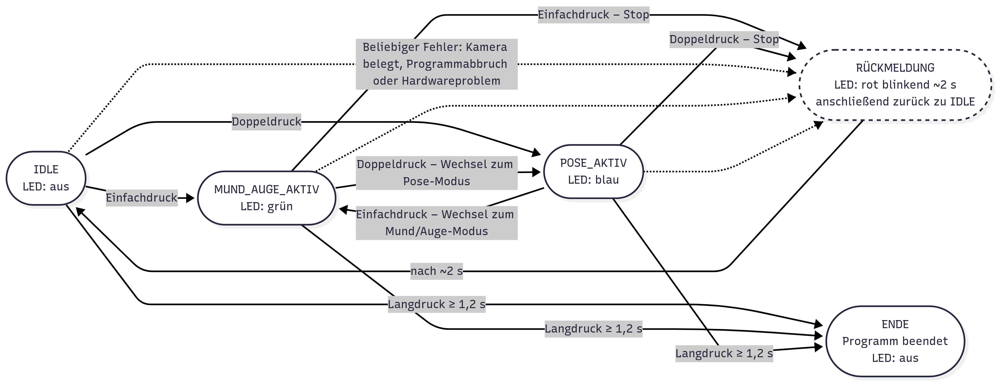

**Deutsch** | [English](README.en.md)

# 🧠 Patienten-Monitoring mit dem Raspberry Pi 📷


Ein kamerabasiertes Patienten-Monitoring auf einem **Raspberry Pi 5**. Es erfasst **Augen-, Mund- und
Körperbewegungen** mit MediaPipe und protokolliert nur anonyme Landmark-Koordinaten – niemals Kamerabilder. Ein
**einzelner Taster** und eine **RGB-LED** steuern das ganze System, es läuft also ohne Tastatur und Bildschirm.

Studienprojekt, Fakultät I – Elektro- und Informationstechnik, Hochschule Hannover, Wintersemester 2025/26.

---

## ✨ Funktionen

### 👁️ Überwachung
* **Augen- & Mund-Monitor** – MediaPipe FaceMesh; erkennt geschlossene Augen über die **Eye Aspect Ratio**
  (EAR < 0,21) und protokolliert die Landmarken von Mund und Augen
* **Körperposen-Monitor** – MediaPipe Pose; protokolliert alle **33 Körper-Landmarken** mit ihrer Sichtbarkeit

### 🔘 Bedienung mit einem Taster (Zustandsautomat)
* **Einfachdruck** → Augen-/Mund-Monitor an/aus (LED 🟢 grün)
* **Doppeldruck** → Posen-Monitor an/aus (LED 🔵 blau)
* **Langdruck** (≥ 1,2 s) → Programm beenden (LED aus)
* **LED-Selbsttest** beim Start und 🔴 rotes Blinken nach jedem Stopp oder Fehler

### 🔒 Datenschutz & Betrieb
* Gespeichert werden nur **normierte Landmark-Koordinaten** als JSON Lines (eine Zeile pro Bild, nach jedem
  Schreiben geflusht)
* **Autostart** mit systemd

---

## 🏗️ Architektur

```
          Taster (GPIO12)                 RGB-LED (GPIO23/24/25)
                 │                                  ▲
                 ▼                                  │
          controller.py ── Zustandsautomat: IDLE / MOUTH_RUNNING / POSE_RUNNING
                 │  startet und stoppt immer genau einen Monitor als Subprozess
       ┌─────────┴──────────┐
       ▼                    ▼
mouth_eye_monitor_picamera2.py   patient_monitor2.py
   FaceMesh + EAR                   Pose
       │                            │
       ▼                            ▼
mouth_eye_<Zeit>.jsonl        pose_<Zeit>.jsonl
```



### 🛡️ Robustheit
* **Kamera-Preflight** – vor dem Start eines Monitors öffnet und schließt der Controller die Kamera (bis zu
  6 Versuche); eine blockierte libcamera-Pipeline führt so zu rotem Blinken statt zu einem hängenden Prozess
* **Sauberes Beenden** – zuerst SIGINT, nach 3 s Timeout `kill()`, dann eine kurze Pause, damit die Kamera frei wird
* **Taster-Auswertung** – Entprellung, Doppelklick-Fenster, Schonzeit nach Start/Stopp und automatische
  Kalibrierung des Ruhepegels (funktioniert mit Pull-up- und Pull-down-Verdrahtung)
* **Nur eine Instanz** – eine Lock-Datei verhindert zwei gleichzeitig laufende Controller
* **Begrenzte Bildrate** – beide Monitore laufen mit 15 fps, das hält CPU-Last und Temperatur niedrig

---

## 🔌 Hardware

| Bauteil | Anschluss |
|---------|-----------|
| Raspberry Pi 5 | – |
| Raspberry Pi Kamera | CSI |
| RGB-LED (gemeinsame Kathode, mit Vorwiderständen) | GPIO23 rot · GPIO24 grün · GPIO25 blau |
| Taster | GPIO12 |

---

## 🛠️ Starten

Auf Raspberry Pi OS:

```bash
sudo apt install python3-picamera2 python3-lgpio
python3 -m venv --system-site-packages ~/pose-env && source ~/pose-env/bin/activate
pip install -r requirements.txt
python3 controller.py
```

**Autostart:** `deploy/run-paro.sh` nach `/usr/local/bin/` und `deploy/paro.service` nach `/etc/systemd/system/`
kopieren, die Pfade darin anpassen und `sudo systemctl enable --now paro` ausführen.

> ⚠️ **Bekannte Einschränkung:** Unter systemd funktionieren Controller, Taster und LED, die Kamera-Monitore liefen
> aber nur zuverlässig aus einer Desktop-Sitzung. Wahrscheinliche Ursachen: die fehlende Anzeige- und
> Sitzungsumgebung (`DISPLAY`, `XDG_RUNTIME_DIR`) und die Zugriffsrechte für libcamera.

---

## 🧰 Technologien

Python · MediaPipe · OpenCV · Picamera2 / libcamera · lgpio · systemd · Raspberry Pi 5
